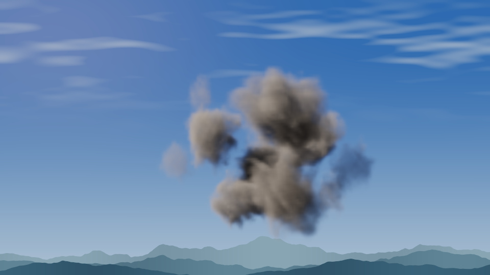
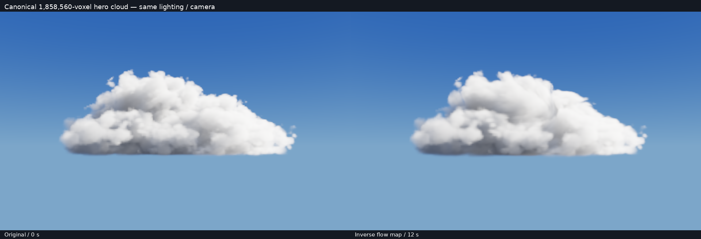
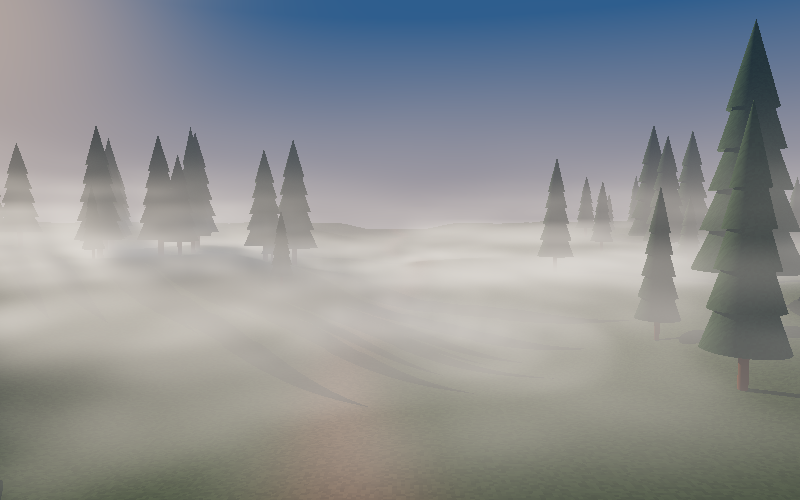
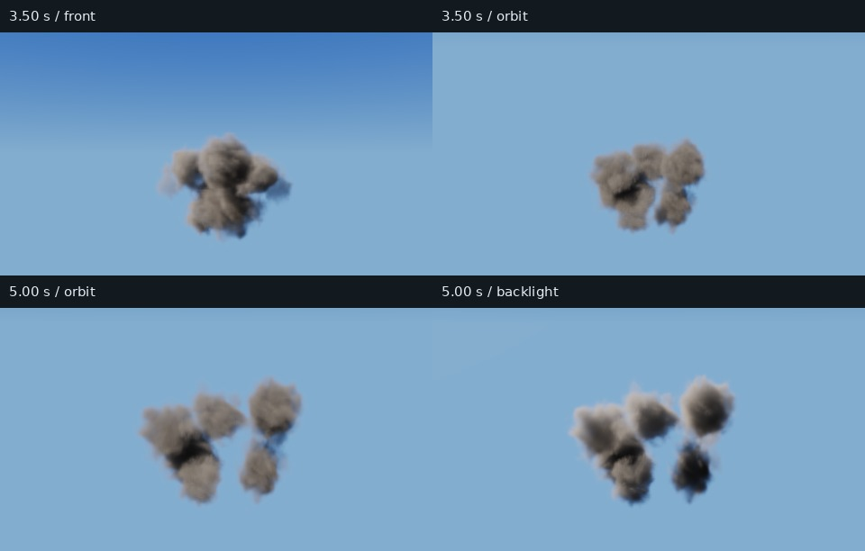

<div align="center">

# Vapor VFX

**Volumetric fields, from simulation to frame.**

Cross-platform volumetric VFX research lab & experimental Rust game SDK.

[**Interactive cloud**](https://ictseoyoungmin.github.io/vapor-vfx/examples/interactive-cloud/) · [Examples](https://ictseoyoungmin.github.io/vapor-vfx/examples.html) · [Developer guide](https://ictseoyoungmin.github.io/vapor-vfx/guide.html) · [Verification status](https://ictseoyoungmin.github.io/vapor-vfx/status.html)

[](https://github.com/ictseoyoungmin/vapor-vfx/actions/workflows/core.yml)


<a href="https://ictseoyoungmin.github.io/vapor-vfx/examples/interactive-cloud/"></a>

<sub>Actual Fidelity Lab render · 176 × 88 × 120 Float32 density field · 224 ray steps. Click to explore the hosted viewer once Pages is deployed.</sub>

</div>

> **Research & source preview.** Native CPU validation has run successfully in [GitHub Actions](https://github.com/ictseoyoungmin/vapor-vfx/actions/runs/45661533068). WASM, hardware GPU/Hybrid, hero cloud parity and game-editor execution still require verification. No production-runtime claim.

## Explore the volume

**Interactive Volumetric Cloud** is the featured example. Generate a canonical cloud in the browser, drag to orbit, right-drag to pan, scroll to zoom, and change lighting. A CPU worker reuses the density and optical-depth cache as the camera moves. It refines the render after interaction; it does not rotate a flat picture. **Bake cloud asset** exports the selected density as indexed GLB surface geometry at 128³, with optional 64³/32³ LODs, PBR material, and the original VPF1 field. GLB is an opaque density-isosurface approximation, not a volumetric renderer.

<table>
<tr>
<td width="50%"><a href="https://ictseoyoungmin.github.io/vapor-vfx/examples/airborne-smoke/"></a><br><b>Airborne smoke</b><br>Offline VFX film and A/B comparison.</td>
<td width="50%"><a href="https://ictseoyoungmin.github.io/vapor-vfx/examples.html"></a><br><b>Animated cloud</b><br>VPA1 Float32 keyframes and streaming.</td>
</tr>
<tr>
<td><a href="https://ictseoyoungmin.github.io/vapor-vfx/examples/terrain-fog/"></a><br><b>Terrain Fog</b><br>Explore the valley, lighting, and fog coverage.</td>
<td><br><b>Volume inspection</b><br>Re-light and inspect saved 3D fields.</td>
</tr>
</table>

All images are generated by the project. Offline films, independent reference rendering, and actual native runtime execution are explicitly distinguished.

## Quick start

No Rust, GPU or optional assets are required for the featured CPU cloud or offline film. Run from the repository root:

```sh
python -m http.server 8000 --bind 127.0.0.1
```

Open [http://localhost:8000/examples/interactive-cloud/](http://localhost:8000/examples/interactive-cloud/) or [the local example index](http://localhost:8000/examples/). Use the hosted links above after the Pages workflow has deployed the site. Optional VPF1/VPA1 data are supplied separately in the full SDK package.

## What Vapor provides

| Component | Purpose | Evidence |
| --- | --- | --- |
| **Fidelity Lab** | Seeded clouds, terrain fog, optical-depth caches, independent fluid experiments | JS CPU reference and research execution |
| **Vapor Core** | MAC fluid simulation, CPU/GPU/one-way Hybrid execution | Native CPU CI passed; GPU/Hybrid pending |
| **Vapor Fields** | VPF1 Float32 fields and VPA1 animation timelines | JS/Python/C++ data interchange tested |
| **Bindings & adapters** | Python, JS/TS, C#/C++, Unity, Godot, Unreal | Interfaces provided; editor execution pending |

### Render a cloud from JavaScript

```js
import { generateFidelityVolume, getFidelityPreset,
         prepareFidelityVolume } from "./bindings/web/fidelity.mjs";

const field = generateFidelityVolume("cumulus_cloud", {
  cells: [72, 36, 48], extent: [144, 72, 96]
});
const style = getFidelityPreset("cumulus_cloud", "medium");
const volume = prepareFidelityVolume({ ...field,
  material: style.material, ...style.lighting });
const frame = volume.render({
  eye: [110, 15, -150], target: [72, 32, 48],
  width: 320, height: 200, steps: 96, background: "sky"
});
// frame.rgba contains display-ready RGBA8 pixels.
```

This example uses the independent JS renderer, not Rust WASM.

### Build and validate the native runtime

Python 3.11+, Rust 1.88+, Node 22, and native platform build tools:

```sh
python tools/validate_runtime.py --build --modes cpu --capture
python tools/validate_cloud_equivalence.py --profile hero --build
```

See [getting started](docs/GETTING_STARTED_KO.md) for the WASM, GPU, Hybrid and language integration paths. Native bindings never silently substitute the independent Lab implementation.

## Project structure

```text
crates/       Rust runtime and FFI
shaders/      GPU compute and optical rendering
bindings/     Python, JS/TS, C#
adapters/     Unity, Godot, Unreal, Three.js
lab/          Independent research and visual studies
examples/     Executable reference and runtime examples
contracts/    Shared field and scene specifications
site/         GitHub Pages templates and actual renders
docs/         Architecture, APIs and validation
tools/        Build, verification and packaging
```

## Documentation & contributions

| Start here | Engineering |
| --- | --- |
| [Getting started](docs/GETTING_STARTED_KO.md) | [Architecture](docs/ARCHITECTURE_KO.md) |
| [Example index](examples/index.html) | [API contract](docs/API_CONTRACT_KO.md) |
| [Fidelity Lab](lab/README.md) | [Validation](docs/VALIDATION_KO.md) |
| [Contributing](CONTRIBUTING.md) | [Milestones](docs/MILESTONES_KO.md) · [Work status](docs/WORK_STATUS_KO.md) |
| [Publishing guide](docs/PUBLISHING_KO.md) | [Changelog](CHANGELOG.md) |

Build the static documentation site:

```sh
python tools/build_pages.py --assets auto
python -m http.server 8000 --directory dist/pages
```

Pages uses a curated build, not a duplicate source tree. The Pages workflow automatically deploys the lightweight curated site on pushes to `main` after the site and reference-example tests pass (`--assets none`). Manual runs can include optional asset groups only after redistribution-rights acknowledgement. Review the applicable license and third-party rights before merging publishable content; this showcase does not grant a new license.

<div align="center"><sub>Vapor VFX · distribution 0.24 · Rust core 0.22.0 · research preview</sub></div>
